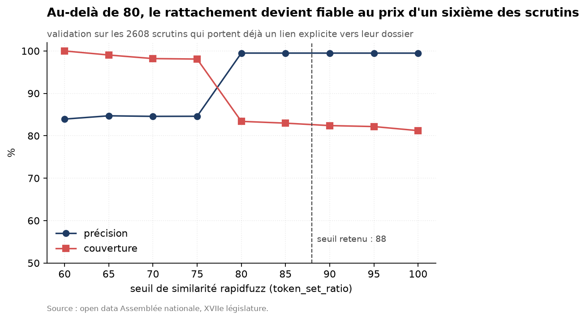
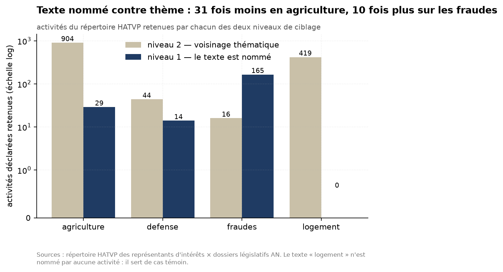
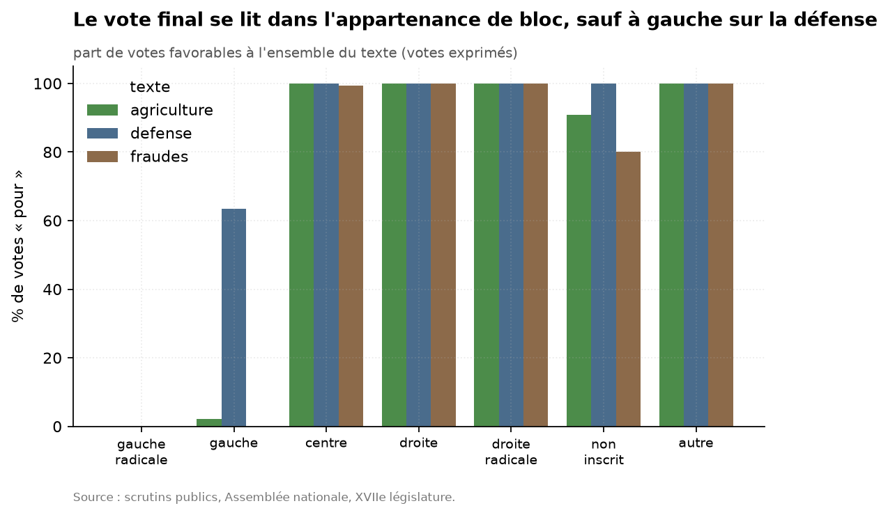
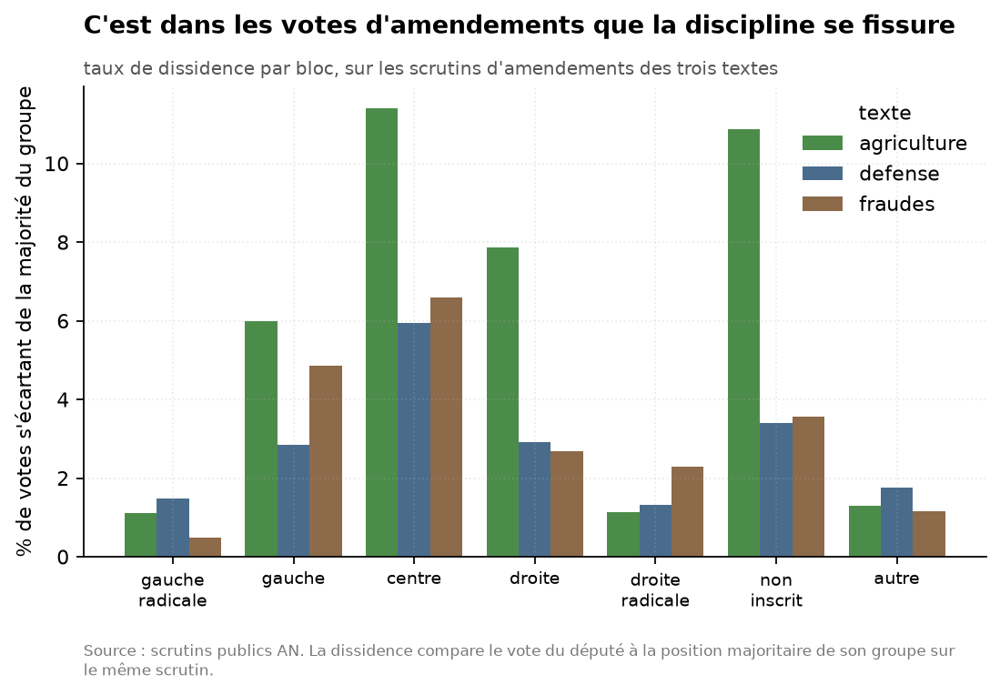
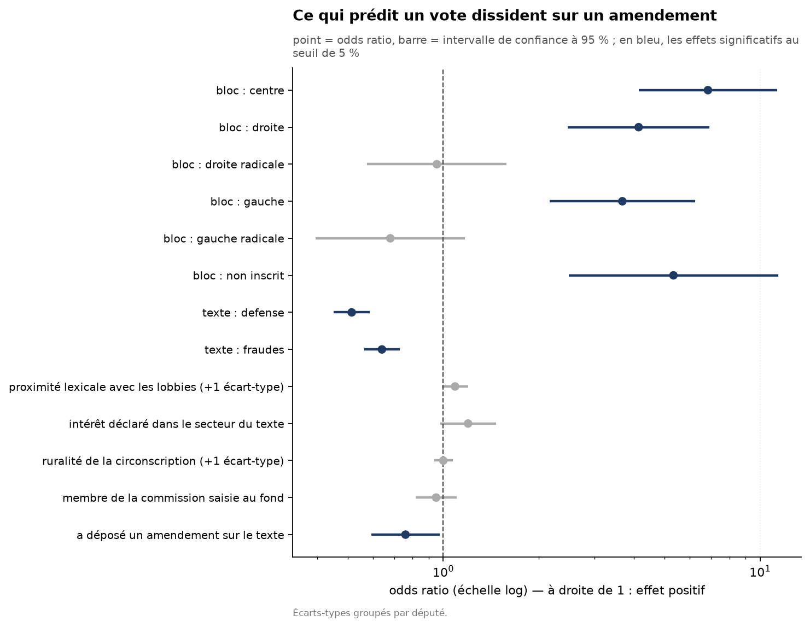

# Cartographier l'influence déclarée des lobbies sur le travail législatif

[](https://github.com/nicolleremanto/Cartographier-lobbie-AssemNat-/actions/workflows/tests.yml)

Projet du cours **Python pour la data science** (ENSAE, 2A — `CSC_4CS08_AE`).

## Membres du groupe

Rémi Nicolle, Ariane Klingler, Jonathan Cador.

## La question

On croise quatre sources officielles pour une seule question : **la présence déclarée de
lobbies sur un texte de loi laisse-t-elle une trace observable dans le travail et les
votes des députés ?**

* qui déclare avoir ciblé quel texte → **répertoire des représentants d'intérêts de la HATVP** ;
* qui a écrit quoi sur ce texte → **amendements de l'Assemblée nationale** ;
* qui a voté quoi → **scrutins publics nominatifs** ;
* ce que les députés déclarent eux-mêmes → **déclarations d'intérêts HATVP**.

L'angle n'est pas de « prouver la corruption » — ni faisable, ni défendable. Il est de
**cartographier une influence déclarée** et de mesurer honnêtement ce qu'on peut, et
surtout ce qu'on ne peut pas, en conclure.

## Le résultat en cinq lignes

1. Sur le **vote final**, la discipline de groupe explique tout : la règle « chacun vote
   comme son bloc » se trompe sur **3 votes sur 547** pour la loi agricole. Il n'y a rien
   de plus à expliquer à ce niveau, et un logit à effets fixes de bloc n'y converge pas.
2. Dans les **scrutins d'amendements**, 4,3 % des votes s'écartent du groupe. La proximité
   lexicale avec les demandes déclarées des lobbies y est associée à **+0,34 point** de
   probabilité de dissidence par écart-type — **non significatif** (p = 0,08), et stable
   pour toutes les largeurs de fenêtre testées.
3. Sur l'**adoption des amendements**, la proximité aux lobbies du texte n'a aucun effet,
   mais le **test placebo** est significativement négatif : la mesure sépare les
   amendements dans le sujet de ceux qui en sortent, et les hors-sujet sont rejetés.
4. Le seul résultat **bien identifié** ne concerne pas les lobbies mais les députés : un
   intérêt privé déclaré dans le secteur d'un texte multiplie par **1,7 à 3,0** la
   probabilité d'y déposer un amendement. Spécialisation ou conflit d'intérêts ? Ces
   données ne tranchent pas.
5. Le travail utile est ailleurs : **rendre les bases comparables**. Le rattachement
   scrutin → dossier atteint 99,5 % de précision après arbitrage temporel ; le
   rapprochement HATVP → texte n'est fiable qu'à condition d'exiger que le texte soit
   **nommé** (100 % sur 20 paires relues à la main, contre 6 % pour un simple voisinage
   thématique).

## Les données

| Source | Volume récupéré | Ce qu'on en tire |
| --- | --- | --- |
| Répertoire HATVP des représentants d'intérêts | 4 094 organisations, **113 075 activités déclarées** | objet, domaine, secteur, type de décideur visé |
| Déclarations des responsables publics (HATVP) | 2 570 déclarations de députés, **11 438 intérêts déclarés** | anciens employeurs, participations, bénévolat |
| Scrutins publics, XVIIe législature | 8 455 scrutins, **1 273 091 votes nominatifs** | sens du vote de chaque député |
| Amendements, XVIIe législature | **126 392 amendements** | auteur, article visé, exposé des motifs, sort |
| Dossiers législatifs | 2 971 dossiers | titres, étapes, fenêtres de débat |
| Acteurs, mandats, organes, **déports** | 649 députés, 10 817 organes, 59 déports | groupe, commission, circonscription, **lien vers la fiche HATVP** |
| API Géo (Etalab) | 34 955 communes | densité et part rurale par département |

Environ **700 Mo** de sources brutes, aucune authentification, tout retéléchargeable par
une commande.

### Les textes étudiés

Quatre textes de la XVIIe législature, choisis parce que le lobbying y est documenté et
les volumes suffisants :

| Clé | Texte | Scrutins | Amendements | Activités HATVP nommant le texte |
| --- | --- | --- | --- | --- |
| `agriculture` | Projet de loi d'urgence pour la protection et la souveraineté agricoles | 422 | 1 592 | 29 |
| `defense` | Projet de loi actualisant la programmation militaire 2024-2030 | 292 | 572 | 14 |
| `fraudes` | Projet de loi relatif à la lutte contre les fraudes sociales et fiscales | 262 | 747 | 165 |
| `logement` | Pour la mobilisation de l'habitat existant | 23 | 68 | **0** |

Le texte `logement` est conservé comme **cas témoin** : aucune activité HATVP ne le nomme,
alors que 419 activités lui sont thématiquement proches. C'est la démonstration la plus
simple que « proximité de thème » n'est pas « ciblage ».

## Rapprocher les bases

Aucune clé commune ne relie ces sources : une activité du répertoire HATVP ne porte ni
numéro de texte ni date précise, seulement un objet en texte libre et une année. Le
rapprochement est donc une inférence, dont on mesure le taux d'erreur.



**Scrutin → dossier législatif.** 5 826 scrutins sur 8 455 n'ont aucun lien explicite vers
leur dossier ; on les rattache par similarité de titre, puis arbitrage par la date. Les
2 608 scrutins déjà liés servent de vérité terrain : au seuil retenu (88), la précision
atteint 99,5 % pour une couverture de 83 %. Limite : les titres qui ne nomment aucun texte
restent non rattachés.



**Activité HATVP → texte.** Deux niveaux : le texte est **nommé** dans l'objet déclaré
(niveau 1, seul utilisé dans les modèles) ou seulement proche par le thème (niveau 2,
descriptif). Pour la loi agricole, on passe de 904 activités à 29 ; pour `logement`, de
419 à 0. Limite : l'ordre de grandeur du titre de la figure vaut pour l'agriculture, pas
pour `fraudes`, où le texte est nommé plus souvent (165) qu'il n'est approché par le thème
(16) ; et la validation repose sur 60 paires relues à la main, stratifiées, dont les
précisions ne s'extrapolent pas en taux global.

## Les résultats en figures

Les 18 figures sont dans [`reports/figures/`](reports/figures/) et commentées une à une
dans [`notebooks/rapport.ipynb`](notebooks/rapport.ipynb) ; sept sont reprises ici, dont
cinq pour les résultats.

### Le vote final se lit dans l'appartenance de bloc



Presque tous les blocs votent à 0 % ou à 100 % : la règle « chacun vote comme son bloc »
se trompe sur 3 votes sur 547 pour la loi agricole, 3 sur 557 pour les fraudes et 37 sur
562 pour la programmation militaire, seul texte à diviser un bloc. Il n'y a donc pas de
variation à expliquer à ce niveau, et un logit à effets fixes de bloc n'y converge pas.

### La discipline se relâche sur les amendements



Sur les scrutins d'amendements, 4,3 % des votes s'écartent de la position majoritaire du
groupe, davantage dans les blocs de gouvernement et chez les non-inscrits. C'est cette variation qui
rend une régression possible. Limite : la dissidence est définie par rapport au groupe
sur le même scrutin, sans information sur une éventuelle consigne de vote.

### La proximité avec les lobbies ne prédit pas la dissidence



Un écart-type de proximité lexicale en plus est associé à +0,34 point de probabilité de
dissidence, effet non significatif (p ≈ 0,08) et petit devant celui du bloc politique.
Le coefficient reste non significatif pour les cinq largeurs de fenêtre temporelle
testées ([figure 14](reports/figures/14_sensibilite_fenetre.png)). Limite : la proximité
mesure une convergence de vocabulaire, pas un contact.

### Ce que mesure réellement la proximité lexicale


Pour chaque amendement, on compare la proximité aux demandes des lobbies ayant nommé le
texte à celle aux lobbies d'un autre texte de l'étude (témoin), sur des corpus de même
taille : la première est plus élevée sur les trois textes, donc la mesure capte bien du
sectoriel. Dans le modèle d'adoption, la proximité réelle n'a aucun effet (odds ratio
1,01, p = 0,89) alors que le témoin est négatif (0,77, p = 0,015) : un amendement hors
sujet est rejeté. Limite : un cosinus TF-IDF ignore le sens de l'amendement, favorable
ou contraire à la demande.

### Les intérêts déclarés des députés


Un député qui déclare un intérêt privé dans le secteur d'un texte a environ trois fois
plus de chances d'y déposer un amendement (odds ratio 3,0, p = 0,0003), l'appartenance à
la commission saisie au fond pesant bien davantage. Limite : avec un second repérage de
l'intérêt sectoriel, l'odds ratio tombe à 1,7 (p = 0,054), et seuls 34 % des libellés
d'intérêts sont rattachés à un secteur ; le sens de la relation est robuste, son ampleur
ne l'est pas.

## Reproduire

### Relire le rapport (le test du correcteur : cloner → installer → Run All)

```bash
git clone https://github.com/nicolleremanto/Cartographier-lobbie-AssemNat-.git
cd Cartographier-lobbie-AssemNat-
pip install -r requirements.txt
```

Puis ouvrir `notebooks/rapport.ipynb` et faire **Run All** : c'est tout. Sur un clone neuf,
la première cellule récupère l'**instantané des données du 2 octobre 2026** (87 Mo, publié
en [release](https://github.com/nicolleremanto/Cartographier-lobbie-AssemNat-/releases/tag/donnees-2026-10-02),
empreinte SHA-256 vérifiée), qui contient les tables trop lourdes pour Git. Le notebook
s'exécute ensuite de bout en bout en moins d'une minute et redonne exactement les chiffres
commentés. Si l'instantané est inaccessible, la même cellule reconstruit les tables depuis
les sources officielles (connexion requise, ~25 minutes, une seule fois). En ligne de
commande : `make rapport`.

### Reconstruire depuis les sources brutes

```bash
python -m venv .venv && source .venv/bin/activate
make installation
make pipeline        # collecte → parsing → matching → variables → qualité → modèles → robustesse → figures
```

Compter ~25 minutes la première fois (8 de téléchargement, 15 de mise à plat des 126 392
fichiers d'amendements), ~1 minute ensuite : rien n'est retéléchargé ni recalculé sans
raison. L'open data de l'Assemblée et le répertoire HATVP évoluant chaque jour, une
reconstruction faite aujourd'hui donne les chiffres du jour, proches mais pas identiques
à ceux du rapport ; le manifeste `data/raw/_manifeste.json` date chaque source. Les tables
reconstruites priment toujours sur l'instantané, qui n'écrase rien.

Les autres cibles :

```bash
make instantane # récupère seulement l'instantané des données du rapport
make rapide     # tout sauf collecte et parsing
make qualite    # les 24 contrôles de qualité des données
make tests      # suite de tests
make rapport    # exécute le notebook de bout en bout
make            # la liste des cibles
```

Une **intégration continue** (GitHub Actions) vérifie à chaque poussée, sur Python 3.11 et
3.12, que les tests passent **et que le notebook s'exécute de bout en bout sur un clone
neuf** (Run All, à partir de l'instantané). Les tests eux-mêmes ne téléchargent aucune
donnée : ils portent sur la logique, avec des tables fabriquées à la main.

## Organisation du dépôt

```
src/lobbynomics/
├── config.py       chemins, sources, textes de loi étudiés, nomenclatures
├── collect.py      téléchargement idempotent + manifeste de provenance
├── parse_an.py     mise à plat de l'open data Assemblée (le JSON y est retors)
├── parse_hatvp.py  mise à plat du répertoire, des déclarations et de l'API Géo
├── matching.py     rapprochement des bases, et sa validation chiffrée
├── features.py     tables d'analyse, proximité lexicale, test placebo
├── models.py       quatre régressions logistiques
├── quality.py      24 contrôles de qualité des données
├── robustesse.py   sensibilité aux choix arbitraires, déterminisme
├── instantane.py   récupération de l'instantané des données du rapport (clone neuf)
├── viz.py          les 18 figures du rapport
└── pipeline.py     orchestration (python -m lobbynomics.pipeline)

notebooks/rapport.ipynb      le rapport
docs/methode.md              le détail méthodologique et ses limites
docs/sources.md              provenance, licences, dates de collecte
docs/journal.md              journal de bord : décisions, erreurs, prochaines étapes
docs/consignes.md            les consignes du cours et où elles sont traitées
docs/rapport-explicatif.pdf  présentation du projet en 22 pages
data/raw/                    sources brutes (hors Git)
data/processed/              tables propres en parquet
reports/figures/             les figures produites
tests/                       67 tests, centrés sur le matching et la qualité
```

## Ce que ce travail ne dit pas

Le répertoire HATVP ne nomme **jamais** le député approché, et ne date ses activités qu'à
l'année. Il n'existe donc aucune mesure d'un contact entre un lobby et un député. Ce qui
est mesuré est une **convergence de vocabulaire** entre les amendements d'un député et les
demandes publiquement déclarées d'une organisation. Elle peut venir d'une influence, d'une
conviction préexistante — un lobby approche d'abord les députés déjà convaincus — ou
simplement du jargon technique commun à un secteur.

Une seule source relie explicitement un député, un intérêt privé et un texte : les
**déports**. Il y en a 59 depuis 2017. `docs/methode.md` détaille toutes ces limites, y
compris celles de la déclaration HATVP elle-même, autodéclarative et contestée par
Transparency International.
