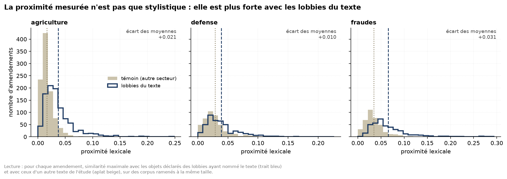
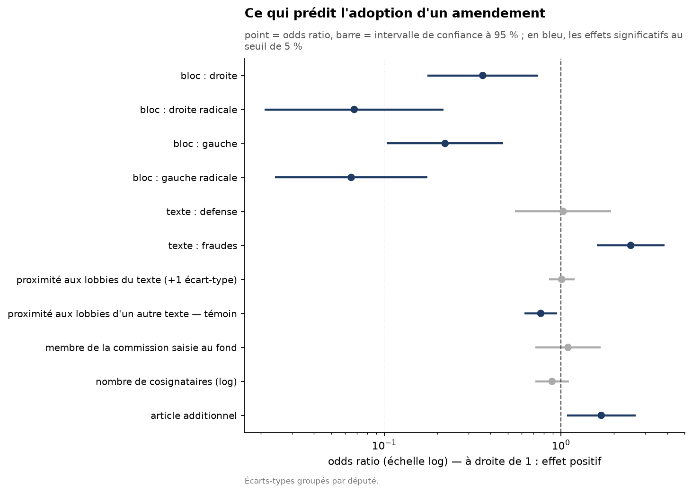
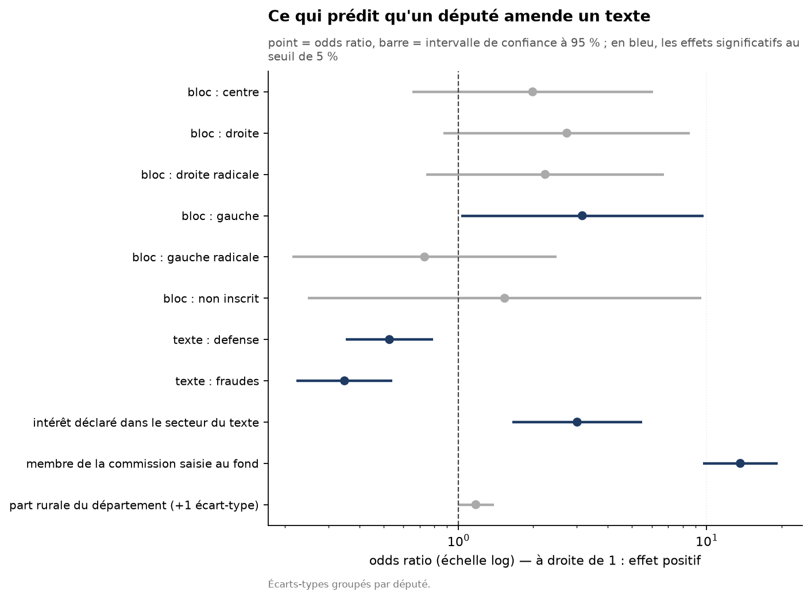

# Cartographier l'influence déclarée des lobbies sur le travail législatif

[](https://github.com/nicolleremanto/Cartographier-lobbie-AssemNat-/actions/workflows/tests.yml)

Projet du cours **Python pour la data science** (ENSAE, 2A — `CSC_4CS08_AE`).

**Membres du groupe :** Rémi Nicolle, Ariane Klingler, Jonathan Cador.

Le rapport est le notebook [`notebooks/rapport.ipynb`](notebooks/rapport.ipynb). Ce
README en donne la version courte, lisible sans rien connaître du sujet.

## Sommaire

1. [En bref](#en-bref)
2. [Le contexte](#le-contexte)
3. [La question et sa difficulté](#la-question-et-sa-difficulté)
4. [La démarche en six étapes](#la-démarche-en-six-étapes)
5. [Les données](#les-données)
6. [Les résultats en sept figures](#les-résultats-en-sept-figures)
7. [Glossaire](#glossaire)
8. [Reproduire](#reproduire)
9. [Organisation du dépôt](#organisation-du-dépôt)
10. [Limites](#limites)

## En bref

**La présence déclarée de lobbies sur un texte de loi laisse-t-elle une trace dans le
travail et les votes des députés ?** Avec les données publiques, on n'en détecte pas : ni
les votes ni l'adoption des amendements ne varient de façon significative avec la
proximité aux demandes déclarées des lobbies. La seule relation nette concerne les
députés eux-mêmes : ceux qui déclarent un intérêt privé dans le secteur d'un texte
l'amendent plus souvent.

| Résultat | Ce qu'il montre | Ce qu'il ne montre pas |
| --- | --- | --- |
| Vote sur l'ensemble d'un texte : la règle « chacun vote comme son bloc » se trompe sur 3 votes sur 547 (loi agricole), 3 sur 557 (fraudes), 37 sur 562 (programmation militaire) | Le bloc politique suffit presque à prédire le vote ; seule exception, la gauche divisée sur la défense | Que les lobbies n'ont aucun rôle : une influence sur la position du groupe entier serait invisible ici |
| Scrutins d'amendements : 4,3 % des votes s'écartent du groupe ; la proximité avec les lobbies y ajoute +0,34 point par écart-type, p = 0,08 | Une association dans le sens attendu, mais faible et non significative, pour toutes les fenêtres temporelles testées | Une absence d'effet : seulement une absence de preuve, avec une mesure indirecte |
| Adoption d'un amendement : la proximité aux lobbies du texte ne joue pas (odds ratio 1,01, p = 0,89) ; celle aux lobbies d'un autre texte la réduit (0,77, p = 0,015) | La mesure sépare les amendements dans le sujet de ceux qui en sortent, et ces derniers sont rejetés | Que parler comme un lobby aide ou dessert un amendement |
| Un député déclarant un intérêt privé dans le secteur d'un texte l'amende plus souvent (odds ratio de 1,7 à 3,0) | Les députés amendent ce qu'ils connaissent ; le sens de la relation résiste au changement de mesure | S'il s'agit de spécialisation ou de conflit d'intérêts |
| Rapprochement lobby-texte : 100 % de liens justes sur 20 paires relues quand le texte est nommé, 6 % pour une simple proximité de thème | Une règle plausible peut être presque toujours fausse, et seule une relecture manuelle le révèle | Un taux d'erreur global : l'échantillon est stratifié |

## Le contexte

**Le lobbying déclaré.** En France, une organisation qui cherche à peser sur une
décision publique — entreprise, fédération professionnelle, syndicat, association,
cabinet de conseil — est un **représentant d'intérêts**. Depuis la loi dite Sapin II
(décembre 2016), ces organisations doivent s'inscrire dans un répertoire public tenu
par la **Haute Autorité pour la transparence de la vie publique (HATVP)** et y déclarer
chaque année leurs activités : sur quel sujet elles sont intervenues, avec quel
objectif, auprès de quel type de décideur. C'est du lobbying *déclaré* : ce qu'une
organisation ne déclare pas n'y figure pas.

**Le travail des députés.** Un projet de loi est discuté article par article. Un
**amendement** est une proposition de modification du texte, accompagnée d'un « exposé
des motifs » qui la justifie. Un amendement discuté a un sort : il est adopté, rejeté,
retiré par son auteur, ou « tombe » parce qu'un vote précédent l'a rendu sans objet. La
plupart des votes de l'Assemblée se font à main levée et ne laissent aucune trace
individuelle ; seuls les **scrutins publics** enregistrent, nom par nom, qui a voté
pour, contre ou s'est abstenu. Ce sont ces votes nominatifs que l'on peut analyser.

**Les intérêts des députés.** Chaque député remet à la HATVP une **déclaration
d'intérêts** : anciens employeurs, participations financières, fonctions de direction,
bénévolat. Enfin, un député qui estime qu'un intérêt personnel doit le tenir à l'écart
d'un vote peut s'en retirer : c'est un **déport**, rendu public. Il y en a 59 depuis
2017.

## La question et sa difficulté

On croise quatre sources officielles : qui déclare avoir ciblé quel texte (répertoire
HATVP), qui a écrit quoi (amendements), qui a voté quoi (scrutins publics), et ce que
les députés déclarent eux-mêmes (déclarations d'intérêts). L'angle n'est pas de
« prouver la corruption », ce qui ne serait ni faisable ni défendable. Il est de
**cartographier une influence déclarée** et de dire précisément ce qu'on peut en
conclure, et ce qu'on ne peut pas. Deux obstacles rendent l'exercice difficile.

**Aucune clé commune ne relie les bases.** Une activité du répertoire ne porte ni numéro
de texte ni date précise : seulement une année et un objet en texte libre, par exemple
« Défendre les loups dans le cadre de la loi d'urgence agricole ». La rattacher à un
dossier législatif n'est pas une jointure mais une **inférence**, qui peut être fausse.
Même à l'intérieur de l'Assemblée, 5 826 scrutins sur 8 455 n'ont aucun lien explicite
vers le texte sur lequel ils portent.

**Le répertoire ne nomme jamais le député approché.** Il dit que des députés ont été
contactés, jamais lesquels. L'exposition d'un député au lobbying n'existe donc dans
aucune base : il faut la construire, et la mesure construite est indirecte.

## La démarche en six étapes

1. **Collecte.** Huit fichiers officiels (environ 700 Mo) sont téléchargés par une
   commande. Un manifeste enregistre l'URL, la date et une empreinte SHA-256 de chacun :
   on sait quelle version des données a produit chaque chiffre.
2. **Mise à plat.** Les fichiers JSON et XML, très imbriqués, deviennent des tables (un
   vote, un amendement, une activité par ligne), soumises à 24 contrôles de qualité.
3. **Rapprochement.** C'est le cœur du travail : relier chaque scrutin à son texte en
   comparant les titres, et chaque activité de lobbying à un texte en exigeant qu'il y
   soit **nommé**. Dans les deux cas, le taux d'erreur est mesuré (figures 1 et 2).
4. **Mesures.** Faute de connaître le député approché, on calcule une **proximité
   lexicale** : à quel point le vocabulaire de ses amendements ressemble aux demandes
   déclarées des lobbies du texte. Un **test placebo** vérifie que cette mesure capte le
   secteur, et pas seulement le style administratif (figure 5).
5. **Modèles.** Des régressions logistiques posent trois questions : la proximité
   prédit-elle un vote contre son groupe ? l'adoption d'un amendement ? un intérêt
   déclaré prédit-il le dépôt d'un amendement ?
6. **Robustesse.** Les choix faits à la main (fenêtre temporelle, résumé de la
   proximité, repérage d'un intérêt) sont modifiés un à un pour voir si les conclusions
   tiennent.

Le détail, y compris les tentatives abandonnées, est dans
[`docs/methode.md`](docs/methode.md).

## Les données

Toutes les sources sont publiques, sous Licence Ouverte, sans authentification ni clé
d'API. Collecte de référence : **2 octobre 2026**.

| Source | Producteur | Volume récupéré | Ce qu'on en tire |
| --- | --- | --- | --- |
| [Répertoire des représentants d'intérêts](https://www.hatvp.fr/agora/opendata/agora_repertoire_opendata.json) | [HATVP](https://www.hatvp.fr/open-data/) | 4 094 organisations, **113 075 activités déclarées** | objet, domaine, secteur, type de décideur visé |
| [Index](https://www.hatvp.fr/livraison/opendata/liste.csv) et [contenu](https://www.hatvp.fr/livraison/merge/declarations.xml) des déclarations des responsables publics | [HATVP](https://www.hatvp.fr/open-data/) | 2 570 déclarations de députés, **11 438 intérêts déclarés** | anciens employeurs, participations, bénévolat |
| [Scrutins publics](https://data.assemblee-nationale.fr/static/openData/repository/17/loi/scrutins/Scrutins.json.zip), XVIIe législature | [Assemblée nationale](https://data.assemblee-nationale.fr/) | 8 455 scrutins, **1 273 091 votes nominatifs** | sens du vote de chaque député |
| [Amendements](https://data.assemblee-nationale.fr/static/openData/repository/17/loi/amendements_div_legis/Amendements.json.zip), XVIIe législature | [Assemblée nationale](https://data.assemblee-nationale.fr/) | **126 392 amendements** | auteur, article visé, exposé des motifs, sort |
| [Dossiers législatifs](https://data.assemblee-nationale.fr/static/openData/repository/17/loi/dossiers_legislatifs/Dossiers_Legislatifs.json.zip) | [Assemblée nationale](https://data.assemblee-nationale.fr/) | 2 971 dossiers | titres, étapes, fenêtres de débat |
| [Acteurs, mandats, organes et déports](https://data.assemblee-nationale.fr/static/openData/repository/17/amo/tous_acteurs_mandats_organes_xi_legislature/AMO30_tous_acteurs_tous_mandats_tous_organes_historique.json.zip) | [Assemblée nationale](https://data.assemblee-nationale.fr/) | 649 députés, 10 817 organes, 59 déports | groupe, commission, circonscription, lien vers la fiche HATVP |
| [API Géo](https://geo.api.gouv.fr/communes?fields=code,nom,population,surface,departement&format=json) | Etalab | 34 955 communes | densité et part rurale par département |

Provenance, licences et pièges de chaque fichier : [`docs/sources.md`](docs/sources.md).

### Les textes étudiés

Quatre textes de la XVIIe législature, choisis parce que le lobbying y est documenté et
les volumes suffisants :

| Clé | Texte | Scrutins | Amendements | Activités HATVP nommant le texte |
| --- | --- | --- | --- | --- |
| `agriculture` | Projet de loi d'urgence pour la protection et la souveraineté agricoles | 422 | 1 592 | 29 |
| `defense` | Projet de loi actualisant la programmation militaire 2024-2030 | 292 | 572 | 14 |
| `fraudes` | Projet de loi relatif à la lutte contre les fraudes sociales et fiscales | 262 | 747 | 165 |
| `logement` | Pour la mobilisation de l'habitat existant | 23 | 68 | **0** |

Le texte `logement` sert de **cas témoin** et sort de la modélisation : aucune activité
ne le nomme. Les groupes politiques sont regroupés en sept **blocs** (gauche radicale,
gauche, centre, droite, droite radicale, non-inscrits, autre) pour éviter des catégories
presque vides.

## Les résultats en sept figures

Les 18 figures du rapport sont dans [`reports/figures/`](reports/figures/) et commentées
une à une dans le notebook. Les sept reprises ici suivent l'ordre du raisonnement.

### 1. Relier un scrutin à son texte : fiable, à un prix connu


**Comment lire.** En abscisse, le seuil de ressemblance exigé entre le titre du scrutin
et celui du dossier. En bleu, la précision (part des rattachements corrects) ; en rouge,
la couverture (part des scrutins rattachés). Le trait pointillé marque le seuil retenu.

**Ce qu'on en conclut.** Les 2 608 scrutins qui portent déjà un lien officiel servent de
corrigé. Entre les seuils 75 et 80, la précision saute de 84,6 % à 99,5 % et la
couverture tombe de 98 % à 83 % : en dessous de 80, on rattache des textes seulement
voisins. On accepte donc de perdre un sixième des scrutins plutôt que de travailler sur
un sixième de lignes fausses. La similarité de titre seule plafonnait à 95,7 % :
plusieurs dossiers portent le même titre (un par lecture), et c'est la date du scrutin
qui les départage.

**Limites.** Un scrutin intitulé « l'ensemble du texte » ne nomme rien : au total, 785
scrutins sur 8 455 restent sans dossier.

### 2. Thème proche ne veut pas dire texte ciblé


**Comment lire.** Deux barres par texte, sur une échelle logarithmique (chaque graduation
vaut dix fois la précédente). En beige, les activités retenues par voisinage thématique
(bon secteur, bon domaine, un mot-clé du texte) ; en bleu, celles dont l'objet **nomme**
le texte.

**Ce qu'on en conclut.** Les deux règles ne mesurent pas la même chose, et l'écart n'a
même pas un sens constant : exiger que le texte soit nommé divise le volume par 31 pour
la loi agricole (904 activités contre 29), mais le multiplie par 10 pour les fraudes (16
contre 165). Le texte `logement` est le plus parlant : 419 activités proches par le
thème, aucune qui le nomme. La relecture manuelle tranche : 20 liens justes sur 20 quand
le texte est nommé, 1 sur les 16 tranchés pour le voisinage thématique. Seule la
première règle alimente les modèles.

**Limites.** La règle stricte perd les organisations qui agissent sans nommer le texte.
Les précisions viennent de 60 paires relues, 20 par niveau, et ne s'extrapolent pas en
taux global.

### 3. Le vote final se lit dans l'appartenance de bloc, à une exception près


**Comment lire.** En abscisse, les sept blocs politiques ; une couleur par texte ; en
hauteur, la part de votes « pour » sur l'ensemble du texte, parmi les votes exprimés.

**Ce qu'on en conclut.** Presque toutes les barres valent 0 % ou 100 % : connaître le
bloc suffit à prédire le vote. La règle « chacun vote comme la majorité de son bloc » se
trompe sur 3 votes sur 547 pour la loi agricole et 3 sur 557 pour les fraudes.
L'exception est la gauche sur la programmation militaire : elle se partage (barre bleue
isolée, ni à 0 ni à 100 %), d'où 37 votes mal prédits sur 562. Il n'y a donc presque
aucune variation à expliquer, et une régression logistique sur ce vote ne peut pas être
estimée : chercher un effet du lobbying à ce niveau n'aurait pas de sens.

**Limites.** La figure porte sur la première lecture ; en deuxième lecture, la règle
explique encore de 93 à 99 % des votes. Elle ne dit rien de ce qui forme la position
d'un bloc.

### 4. La proximité avec les lobbies ne prédit pas la dissidence

On descend donc d'un niveau : sur les 970 scrutins d'amendements des trois textes,
4,3 % des 89 472 votes s'écartent de la position majoritaire du groupe
([figure 05](reports/figures/05_dissidence_par_bloc.png)). C'est cette variation que le
modèle cherche à expliquer.


**Comment lire.** Une ligne par variable. Le point est l'odds ratio (voir le
[glossaire](#glossaire)) : à droite du trait vertical, la variable est associée à plus
de dissidence, à gauche à moins. La barre est l'intervalle de confiance à 95 % ; si elle
coupe le trait, l'effet n'est pas distinguable de zéro et la ligne est grise.

**Ce qu'on en conclut.** Les deux variables liées au lobbying sont juste à droite du
trait, mais grises : +0,34 point de probabilité de dissidence par écart-type de
proximité lexicale, +0,72 point pour un intérêt déclaré dans le secteur (p = 0,08 dans
les deux cas). On ne conclut pas à un effet, et l'ordre de grandeur est faible devant
celui du bloc politique (5 à 8 points). Le seul effet net va dans l'autre sens : un
député qui a déposé un amendement sur le texte s'écarte moins de son groupe (−1,09
point, p = 0,03).

**Limites.** La dissidence se mesure par rapport au vote majoritaire du groupe, sans
information sur une consigne ; la proximité mesure un vocabulaire partagé, pas un
contact. Le résultat reste non significatif pour les cinq largeurs de fenêtre testées
([figure 14](reports/figures/14_sensibilite_fenetre.png)).

### 5. La mesure de proximité capte bien le secteur



**Comment lire.** Un panneau par texte ; en abscisse, la proximité lexicale d'un
amendement, en ordonnée le nombre d'amendements. Le trait bleu donne la proximité aux
lobbies qui ont nommé le texte ; l'aplat beige, celle aux lobbies d'un **autre** texte
de l'étude, le témoin. Les traits verticaux marquent les deux moyennes.

**Ce qu'on en conclut.** Si la mesure ne captait que le style administratif, les deux
distributions se superposeraient. Or la courbe bleue est décalée vers la droite dans les
trois panneaux (écart des moyennes de +0,010 à +0,031) : un amendement agricole
ressemble davantage aux demandes des lobbies agricoles qu'à celles des lobbies de la
défense. Le témoin n'est pas nul pour autant : une part de la proximité ne doit rien au
secteur.

**Limites.** Les valeurs sont faibles dans l'absolu et l'écart est mince sur la défense.
Les deux corpus sont ramenés à la même taille, sans quoi le plus gros gagnerait
mécaniquement. Ce test valide l'instrument, pas une influence.

### 6. Parler comme les lobbies n'aide pas un amendement, sortir du sujet le dessert



**Comment lire.** Comme la figure 4, pour l'adoption d'un amendement. On ne garde que
les 1 145 amendements de députés réellement tranchés, adoptés ou rejetés : un amendement
retiré ou tombé n'a pas été jugé sur son contenu. Les blocs se lisent par rapport au
centre.

**Ce qu'on en conclut.** La proximité aux lobbies du texte est posée sur le trait (odds
ratio 1,01, p = 0,89) : aucun effet. Le témoin est significativement en dessous de 1
(0,77, p = 0,015) : un amendement dont le vocabulaire ressemble aux demandes d'un autre
secteur est moins souvent adopté. Sans le placebo, on aurait conclu « pas d'effet » sans
voir ce que la mesure capte : elle sépare les amendements dans le sujet de ceux qui en
sortent. Ce qui pèse vraiment est politique : par rapport au centre, la cote d'adoption
est divisée par 3 à droite et par 15 à la gauche radicale.

**Limites.** La mesure compte des mots et ignore le sens : un amendement qui interdit
une substance et une demande qui veut la réautoriser partagent presque tout leur
vocabulaire.

### 7. Les députés amendent les textes de leur secteur



**Comment lire.** Même lecture, pour la probabilité qu'un député dépose au moins un
amendement sur un texte (1 639 couples député-texte).

**Ce qu'on en conclut.** C'est la seule relation qui ne repose sur aucune inférence :
l'intérêt est déclaré par le député, le dépôt d'un amendement est un fait. Un intérêt
privé déclaré dans le secteur du texte va de pair avec une cote d'amender ce texte trois
fois plus élevée (odds ratio 3,0, p = 0,0003) ; l'appartenance à la commission chargée
du texte pèse bien davantage (odds ratio proche de 14). Ce n'est pas une mise en cause :
un ancien agriculteur qui amende la loi agricole fait ce pour quoi il a été élu.

**Limites.** L'ampleur n'est pas robuste : avec une seconde façon de repérer l'intérêt,
l'odds ratio tombe à 1,7 (p = 0,054). Seuls 34 % des intérêts déclarés ont pu être
rattachés à un secteur. On retient le sens de la relation et le bas de la fourchette.

## Glossaire

| Terme | En clair |
| --- | --- |
| **HATVP** | Haute Autorité pour la transparence de la vie publique : autorité indépendante qui tient le répertoire des lobbies et reçoit les déclarations d'intérêts des élus. |
| **Représentant d'intérêts** | Nom juridique d'un lobby : organisation qui intervient auprès de décideurs publics pour peser sur une décision, et doit le déclarer. |
| **Déport** | Décision d'un député de ne pas prendre part à un vote en raison d'un intérêt personnel. Seule source qui nomme ensemble un député, un intérêt et un texte. |
| **Scrutin nominatif** | Vote dont le détail est publié nom par nom, ce qui permet de savoir comment chaque député a voté. |
| **Dissidence** | Vote d'un député différent de la position majoritaire de son groupe sur le même scrutin. |
| **Proximité lexicale (TF-IDF, cosinus)** | Chaque texte est résumé par ses mots, les mots rares pesant plus que les mots courants (TF-IDF). Le cosinus compare deux textes ainsi résumés : 0 s'ils n'ont aucun mot en commun, 1 s'ils emploient les mêmes mots dans les mêmes proportions. |
| **Test placebo** | Refaire la mesure là où elle ne devrait rien donner (ici, avec les lobbies d'un autre secteur). Si le résultat est le même, la mesure ne capte pas ce qu'on croit. |
| **Odds ratio** | Rapport de cotes, la cote étant la probabilité d'un événement rapportée à celle de son contraire. À 1, la variable ne change rien ; à 3, elle triple la cote ; en dessous de 1, elle la réduit. |
| **p-value** | Probabilité d'observer un écart au moins aussi grand par le seul hasard s'il n'y avait aucun effet. En dessous de 0,05, on parle par convention d'effet significatif. |
| **Effets fixes** | Indicatrices ajoutées au modèle (ici une par bloc et une par texte) pour ne comparer les députés qu'à bloc et texte identiques. |

## Reproduire

### Relire le rapport : cloner, installer, Run All

```bash
git clone https://github.com/nicolleremanto/Cartographier-lobbie-AssemNat-.git
cd Cartographier-lobbie-AssemNat-
pip install -r requirements.txt
```

Puis ouvrir `notebooks/rapport.ipynb` et faire **Run All**. Python 3.11 ou plus récent
est requis. Le notebook s'exécute en moins d'une minute et redonne exactement les
chiffres commentés. En ligne de commande : `make rapport`.

**Sur SSP Cloud.** La même procédure s'applique : ouvrir un service Jupyter-python,
lancer un terminal, y exécuter les trois commandes ci-dessus, puis ouvrir
`Cartographier-lobbie-AssemNat-/notebooks/rapport.ipynb` et faire Run All.

**D'où viennent les données à la relecture.** Les sources brutes (environ 700 Mo) ne
sont pas dans Git. Deux choses permettent pourtant de relire le rapport sans attendre :

* les petites tables d'analyse et les sorties des contrôles (23 fichiers parquet et
  CSV, environ 5,6 Mo) sont versionnées, parce que le notebook les lit directement et
  que l'une d'elles, l'audit annoté à la main, n'est pas reproductible par le code ;
* les tables trop lourdes pour Git sont publiées dans un **instantané des données du
  2 octobre 2026** (87 Mo, en
  [release](https://github.com/nicolleremanto/Cartographier-lobbie-AssemNat-/releases/tag/donnees-2026-10-02)),
  que la première cellule du notebook télécharge seule et dont l'empreinte SHA-256 est
  vérifiée.

Si l'instantané est inaccessible, la même cellule reconstruit les tables depuis les
sources officielles (environ 25 minutes, une seule fois).

### Reconstruire depuis les sources brutes

```bash
python -m venv .venv && source .venv/bin/activate
make installation
make pipeline        # collecte → parsing → matching → variables → qualité → modèles → robustesse → figures
```

Compter environ 25 minutes la première fois (8 de téléchargement, 15 de mise à plat des
126 392 fichiers d'amendements), environ 1 minute ensuite. Les sources évoluant chaque
jour, une reconstruction faite aujourd'hui donne des chiffres proches mais pas
identiques à ceux du rapport ; le manifeste `data/raw/_manifeste.json` date chaque
source. Les tables reconstruites priment sur l'instantané, qui n'écrase rien.

Les autres cibles :

```bash
make instantane # récupère seulement l'instantané des données du rapport
make rapide     # tout sauf collecte et parsing
make qualite    # les 24 contrôles de qualité des données
make tests      # suite de tests
make rapport    # exécute le notebook de bout en bout
make            # la liste des cibles
```

### Intégration continue

À chaque poussée, GitHub Actions vérifie sur Python 3.11 et 3.12 que les 67 tests
passent, **et que le notebook s'exécute de bout en bout sur un clone neuf** (Run All, à
partir de l'instantané). Les tests ne téléchargent aucune donnée : ils portent sur la
logique, avec des tables fabriquées à la main.

## Organisation du dépôt

```
src/lobbynomics/
├── config.py       chemins, sources, textes de loi étudiés, nomenclatures
├── collect.py      téléchargement idempotent + manifeste de provenance
├── parse_an.py     mise à plat de l'open data Assemblée (le JSON y est retors)
├── parse_hatvp.py  mise à plat du répertoire, des déclarations et de l'API Géo
├── matching.py     rapprochement des bases, et sa validation chiffrée
├── features.py     tables d'analyse, proximité lexicale, test placebo
├── models.py       quatre régressions logistiques
├── quality.py      24 contrôles de qualité des données
├── robustesse.py   sensibilité aux choix arbitraires, déterminisme
├── instantane.py   récupération de l'instantané des données du rapport (clone neuf)
├── viz.py          les 18 figures du rapport
└── pipeline.py     orchestration (python -m lobbynomics.pipeline)

notebooks/rapport.ipynb      le rapport
docs/methode.md              le détail méthodologique et ses limites
docs/sources.md              provenance, licences, dates de collecte
docs/journal.md              journal de bord : décisions, erreurs, prochaines étapes
docs/consignes.md            les consignes du cours et où elles sont traitées
docs/rapport-explicatif.pdf  présentation du projet en 22 pages
data/raw/                    sources brutes (hors Git)
data/processed/              tables propres en parquet
reports/figures/             les figures produites
tests/                       67 tests, centrés sur le matching et la qualité
```

## Limites

Détaillées dans [`docs/methode.md`](docs/methode.md), par ordre de gravité :

1. **Le répertoire est autodéclaratif.** Une organisation qui ne déclare rien est
   invisible, et l'exhaustivité du registre est contestée, notamment par Transparency
   International. On mesure le lobbying déclaré, part inconnue du lobbying réel.
2. **Aucune mesure de contact, donc aucune causalité.** La convergence de vocabulaire
   peut venir d'une influence, d'un lobby qui s'adresse d'abord aux députés déjà
   convaincus, ou du jargon commun à un secteur.
3. **Pas de datation fine.** Une activité n'est datée qu'à l'année ; la fenêtre de débat
   est élargie de six mois de part et d'autre, choix arbitraire mais testé.
4. **Un rapprochement prudent, donc incomplet.** On préfère 208 rattachements sûrs à
   1 383 douteux.
5. **Une mesure lexicale**, qui ignore le sens des textes comparés.
6. **Une seule législature**, politiquement très fragmentée.

Une seule source relie explicitement un député, un intérêt privé et un texte : les 59
déports, trop peu nombreux pour une statistique. Un seul est vérifiable à l'échelle d'un
texte entier : sur les 292 scrutins postérieurs, le député concerné n'apparaît que dans
un vote. Les données ne disent pas pourquoi, mais elles montrent qu'un engagement public
devient contrôlable dès qu'une source nomme à la fois la personne et le texte, ce qui
manque précisément au répertoire des lobbies.
